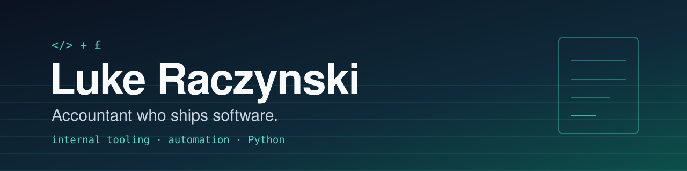

  

  

  
  
  
  
  
  
  

---

## 👋 About me

I'm a **software developer** who builds internal tooling and automation, mostly in Python, with the occasional native macOS app in Swift. I'm also an accountant: I run **Lean Ledger Ltd**, a practice for tech-forward startups and small businesses in London.

Having both jobs is the point. I know where the hours go in a real practice, so I build the tools that give them back: statement converters, trial balance mappers, client registers and Companies House lookups. I like software that is **local-first**, **auditable** and honest about what it doesn't know, because a number you can't trace is a number you can't trust.

## 🔭 What I'm building

| Project | What it does | Stack |
|---|---|---|
| **Fieldbase** | Client register for an accountancy practice: your data beside Companies House data, every change recorded | Python, SQLite |
| **Transaction Converter** | Auditable PDF bank statement → CSV/Excel using OCR and LLM extraction, with checks against the PDF's own text | Python |
| **LeanTools** | Companies House TUI, TB → TaxCalc mapping and more, exposed to AI assistants over MCP | Python, MCP |
| **TextLift** | macOS menu bar app that copies text (and QR codes) from anywhere on screen, fully on-device | Swift, Vision |

> Most of these live in private repos for now. Happy to talk through any of them.

## 🧰 How I work

- **Python first** for data and back-office tooling (`uv`, Textual TUIs, Django/Wagtail for the web side)
- **Swift** for small native macOS utilities, **Rust** when I want something fast and sturdy
- **LLMs as a component, not magic:** confidence scores, audit trails and human review wherever the numbers matter
- Built day to day with **Claude Code** and MCP servers

## 🌱 Currently exploring

- Wiring more of the practice workflow into MCP so an assistant can do the boring parts safely
- Better OCR sanity checks for scanned financial documents

## 📫 Say hello

- Business: [leanledger.co.uk](https://leanledger.co.uk)
- Based in **London** 🇬🇧

Numbers should add up. So should the code.

